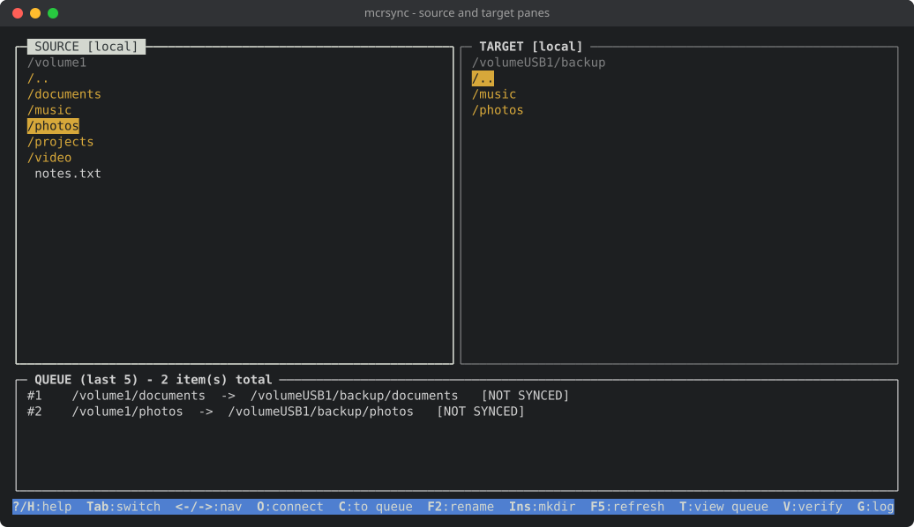
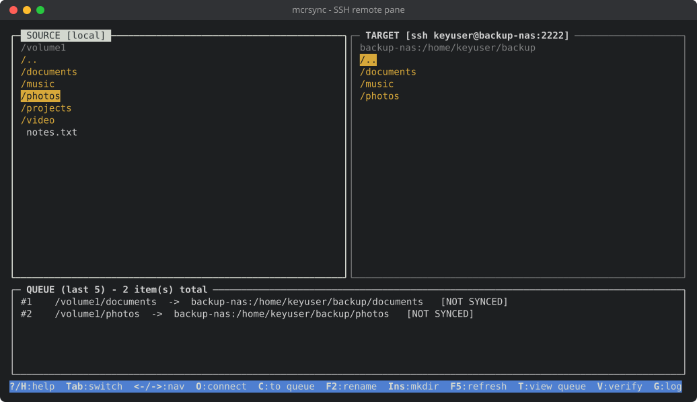
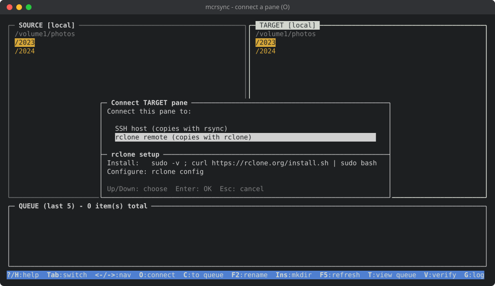
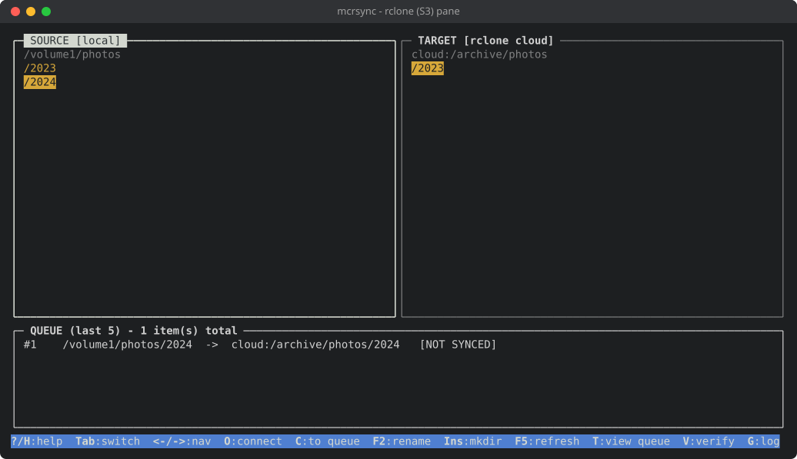
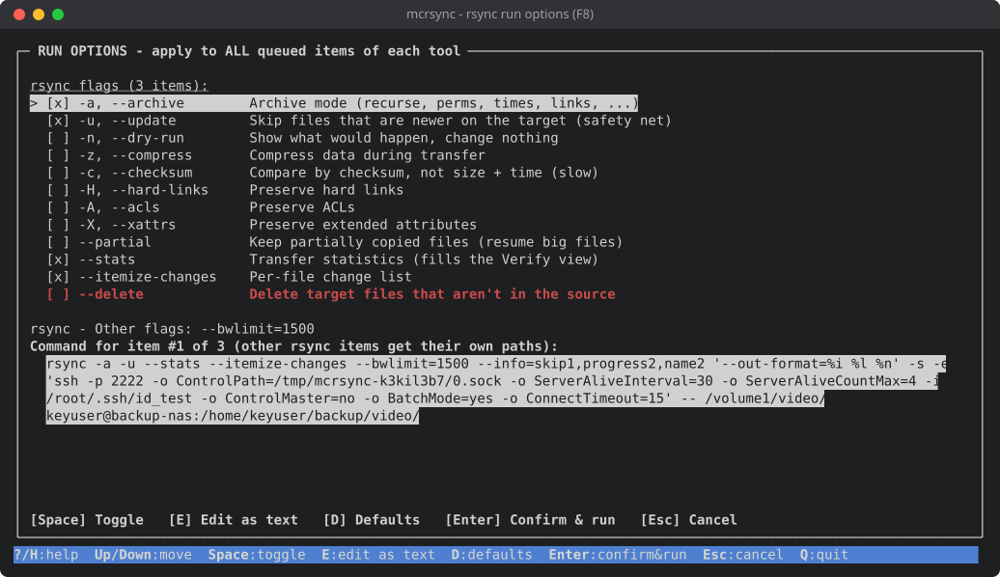
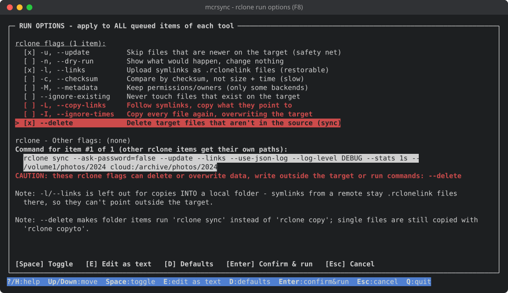
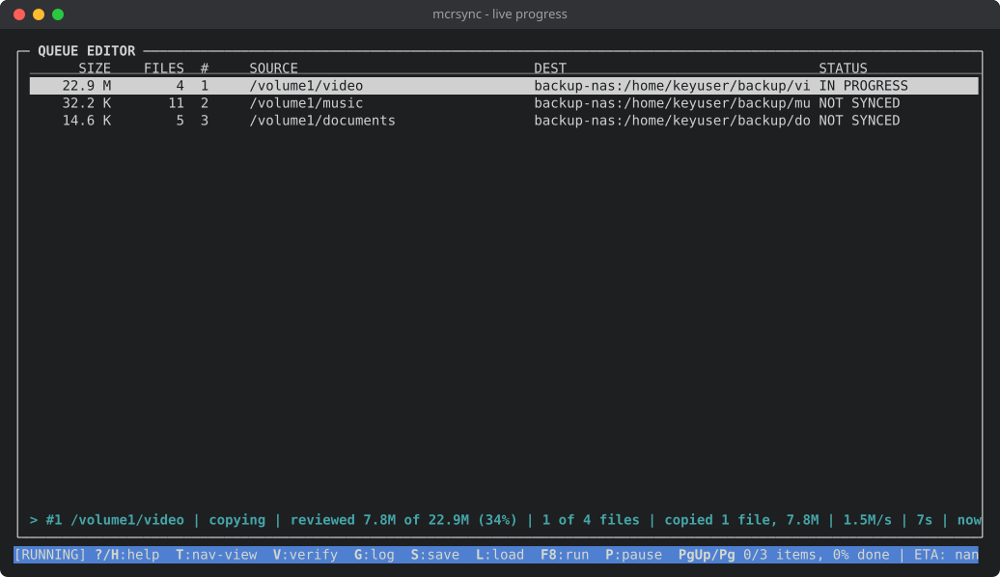
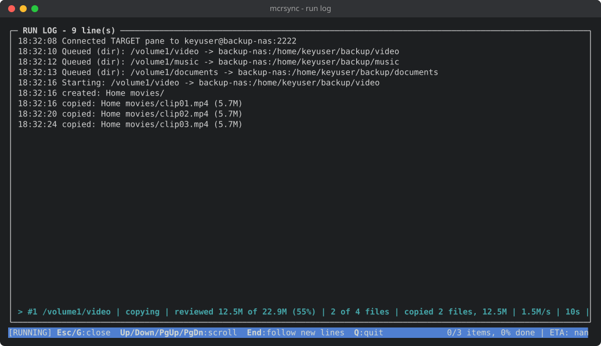

# mcrsync

A Midnight-Commander-style `rsync` queue manager built for Python 3.4+ by Claude; originally by JRPdata. Since the original version, remote SSH and `rclone` support has been added, including a test suite. Also inspired by the [Total Commander](https://ghisler.com) application for Windows.

`mcrsync` provides a visual, dual-pane terminal interface for building, editing, and executing large batches of `rsync` file transfers. It was originally designed for managing localized backup routines on older Network Attached Storage (NAS) hardware, offering modern convenience while maintaining legacy compatibility.



## Install

### Run without installing

It's a single file. Download it and run it:

```bash
curl -LO https://github.com/winternet-studio/mcrsync/releases/latest/download/mcrsync.py
python3 mcrsync.py
```

### Install as a command

To run it as `mcrsync` from any folder, install it in a folder on your `PATH`:

```bash
sudo curl -Lo /usr/local/bin/mcrsync https://github.com/winternet-studio/mcrsync/releases/latest/download/mcrsync.py
sudo chmod +x /usr/local/bin/mcrsync
```

Without `sudo`, use `~/.local/bin/mcrsync` instead. If that folder isn't on your `PATH` yet, add `export PATH="$HOME/.local/bin:$PATH"` to `~/.bashrc` and open a new terminal.

### Update

```bash
# If installed as a command (prefix sudo if installed in /usr/local/bin)
mcrsync selfupdate

# If not installed
python3 mcrsync.py selfupdate

# Show the installed version
mcrsync --version
```

## Usage

Pick a file or folder in the left pane, go to the destination in the right pane (switch with `Tab`), press `C` to queue it, then `F8` and `Enter` to run. Press `H` for help. See [Example Workflow](#example-workflow) for more.

## Features

* **Dual-Pane Navigation:** Browse your source and target directories side-by-side. 
* **Remote over SSH:** Either pane can be switched to a remote host (press `O`), to push to or pull from another NAS or Linux server. Log in with a key file or a password; the password is asked by `ssh` itself and never stored. A dropped connection pauses the run until you log in again. Host names and IPv4 addresses are supported (not IPv6).
* **Cloud storage via rclone:** A pane can also show a remote from your own `rclone config` (S3, Backblaze B2, Google Drive, OneDrive, WebDAV, ...). Items to or from it are copied with `rclone` instead of `rsync`, with the same queue, progress, conflict detection and Verify view. Cloud-to-cloud works too. See [rclone panes](#rclone-panes).
* **Resumable Queues:** Save your entire queue and custom flags to a JSON file. You can pause, quit, reload, and resume right where you left off. Remote hosts are saved with the queue (never passwords).
* **Background Sizing:** Each item's total size and number of files (SIZE and FILES columns in the queue view) are calculated in the background as you build your queue.
* **Live Progress:** While a run is going, a progress line shows the running item's phase, how much of it has been reviewed, what was actually copied, speed, conflicts, elapsed time and the current file. The status bar shows whole-queue progress and ETA. A run log (`G`) lists every copied file, conflict, error and connection event.
* **Conflict Verification:** A dedicated "Verify" view lets you review skipped files, renamed items, and errors after a run, allowing you to manually resolve conflicts (Skip, Rename existing, or Auto-rename incoming). Resolutions never overwrite an existing file.
* **Safe Dry Runs:** Tick `-n, --dry-run` on the `F8` screen to see what would be copied and which files would conflict, without touching anything.
* **Legacy Friendly:** Targets Python 3.4+. Purposely avoids newer features (like f-strings or `os.scandir`) targetting older environments.

See [Safety](#safety) for the full list of safeguards.

## Screenshots

Pushing to a NAS over SSH:



Connecting a pane (`O`) and copying to S3 with rclone:




Run options (`F8`) for rsync and rclone, live progress and the run log (`G`):






To update the screenshots, see [test/README.md](test/README.md#screenshots).

---

## Dependencies

* **Python 3.4 or higher** (Uses strictly standard libraries: `curses`, `json`, `threading`, `subprocess`, etc.)
* **rsync** installed on the host system.
* **For remote panes:** the OpenSSH client (`ssh`) locally, and rsync 3.1 or newer plus a POSIX shell on the remote host (any Linux server or Synology NAS will do).
* **For rclone panes:** [rclone](https://rclone.org/) 1.60 or newer in `PATH`, with your remotes set up via `rclone config`.
* **GNU Screen or tmux (Highly Recommended):** Because large transfers can take hours, it is highly recommended to run this script inside a multiplexer like `screen` so you can detach and safely close your SSH session without interrupting the queue.
* **A terminal of at least 48 x 15 characters.**

---

## Example Workflow

1. **Launch:** Run the program (preferably inside `screen`):
   ```bash
   python3 mcrsync.py
   ```
2. **Build the Queue:** Use `Tab` to switch between the left (Source) and right (Target) panes. Highlight a file or directory on the left, navigate to your desired destination on the right, and press `C` to add it to the queue.
   * **Remote host (optional):** In the pane that should be remote, press `O`, choose *SSH host* and fill in user, host, port, base path and (optionally) a key file. Leave the key file blank to log in with a password; `ssh` asks for it in the plain terminal. The other pane must then be local. Your entries (but not the password) are remembered in `~/.mcrsync.yaml`.
   * **Cloud storage (optional):** Press `O`, choose *rclone remote*, pick one of your remotes and type the folder to start in (e.g. `bucket/photos`). The other pane can be local or another rclone remote.
3. **Review and Run:** Once your queue is built, press `F8` to open the Run Options.
4. **Customize Flags:** (Optional) Switch common flags on or off with `Up`/`Down` and `Space`, or press `E` to edit all flags of the selected tool as text. rsync and rclone have separate flags. The screen shows the exact command each tool will run and warns about risky flags.
5. **Start:** Press `Enter` to confirm and begin the queue.
6. **Save:** Press `S` to save the queue and your flags to a `.json` file, so you can load it (`L`) and resume later.

*(Note: The ETA is a rough estimate based on total byte size.)*

---

## Advanced `rsync` Options

By default, the script uses `-a -u --stats --itemize-changes`. However, depending on your backup target, these might not be desirable for some reason (i.e. standard archive flags might cause permission errors.)

If you only care about transferring the actual files and want to ignore users/permissions, press `F8` then `E` and use this robust alternative set of flags:

```text
-a -u --whole-file --no-perms --no-owner --no-group --partial --partial-dir=.rsync-partial --stats --itemize-changes
```

**What these flags do:**
* `-a`: Archive mode (recurses into directories).
* `-u`: Update mode (skips files that are newer on the receiver). **Crucial for safety.**
* `--whole-file`: Disables delta-transfer algorithm. Faster for local transfers or when CPU/Disk IO on the NAS is a bigger bottleneck than network speed.
* `--no-perms --no-owner --no-group`: Ignores permission mappings. Ideal for backing up to a drive with a different filesystem or when user accounts don't match between the source and target.
* `--partial` and `--partial-dir=.rsync-partial`: Keeps partially transferred files if the connection drops, putting them in a hidden folder so large files can resume properly next time.
* `--stats --itemize-changes`: `--stats` fills in the Verify view's counts. `--itemize-changes` is harmless but not needed.

Values must be attached with `=` (`--exclude='*.tmp'`, not `--exclude '*.tmp'`), since a separate word would be passed on as one more path to copy. The F8 screen marks risky flags *CAUTION* and flags mcrsync doesn't know *CHECK*.

---

## Keyboard Shortcuts

### Global Keys (Available in all views)
* `?` or `H`: Show Help.
* `T`: Toggle between NAV (browser) view and QUEUE editor view.
* `V`: Open/close the VERIFY view (useful to inspect after a run).
* `G`: Open/close the RUN LOG. `Up`/`Down`/`PgUp`/`PgDn`/`Home` scroll back, `End` follows new lines again.
* `S`: Save the current queue and flags to a JSON file.
* `L`: Load a queue from a JSON file. If its flags differ from yours, they are shown in full and you choose whether to use them.
* `F8`: Open the Run Options screen to run the queue.
* `P`: Pause / resume queue execution (between items). If the run paused because a connection was lost, `P` logs in again first.
* `Q`: Quit (asks for confirmation).

### NAV View (File Browser)
* `Tab`: Switch active pane between SOURCE (left) and TARGET (right).
* `Left` / `Backspace`: Go to the parent directory.
* `Right` / `Enter`: Enter the highlighted directory (`..` goes to the parent).
* `Home` / `End`: Jump to the first / last item.
* `F5`: Refresh both panes (offers to log in again if a remote pane lost its connection).
* `O`: Connect the active pane to a remote host via SSH or to an rclone remote, or disconnect it and return to the local folder.
* `C`: Queue a copy (Left pane selection -> Right pane current directory).
* `F2`: Rename the selected file/folder. Never replaces an existing file or folder.
* `Insert`: Create a new folder in the active pane.

### QUEUE View (Editor)
* `Up` / `Down` / `PgUp` / `PgDn`: Navigate the list.
* `D` or `Delete`: Remove the selected item from the queue (not the one being copied right now).

### RUN OPTIONS Screen (`F8`)
rsync and rclone each have their own flags, which apply to every queue item copied with that tool. Only the tools the queue uses are shown.
* `Up` / `Down`: Move through the flag checkboxes. `Space`: Switch the selected flag on or off.
* `E`: Edit all flags of the selected tool as text (shell-style quoting). `D`: Restore that tool's defaults.
* `Enter`: Confirm and start the run (asks again if `-u`/`--update` is off). `Esc`: Go back without running.

### Typing Text (all popups and prompts)
* `Enter`: accept. `Esc`: cancel without changing anything. `Backspace`: delete a character. `Ctrl-U`: clear the field.
* In popups with buttons: `Tab` / `Down` moves to the next field or button, `Shift-Tab` / `Up` moves back, `Left` / `Right` switch between `[ OK ]` and `[ Cancel ]`.

### VERIFY View (Post-Run Review)
* `Tab`: Cycle through COPIED, SKIPPED, RENAMED, and ERRORS tabs.
* `Enter`: (On a SKIPPED row) Resolve a conflict by choosing to Skip, Rename the existing target file, or Auto-rename the incoming file.

---

## Status Codes
While monitoring your queue, items will display one of the following statuses:
* **NOT SYNCED:** Queued, but not yet attempted.
* **IN PROGRESS:** Currently being copied.
* **SYNCED OK:** Completed cleanly.
* **SYNC FAIL:** `rsync` or `rclone` returned a hard error, or the item was refused before running (see [Safety](#safety)). The ERRORS tab in Verify shows why.
* **INCOMPLETE:** The copy ran, but some files were skipped because the target copy was newer than the source. Check the Verify (`V`) view to manually resolve.
* **DRY RUN OK:** A dry run (`-n`) found nothing wrong. Nothing was copied, so a real run still processes the item.
* **DRY RUN INCOMPLETE:** A dry run found files that are newer in the target. They can only be resolved after a real run.

---

## Files

* **`~/.mcrsync.yaml`:** your SSH and rclone connection entries (never passwords). Each user has their own, readable only by them. Installed in `/usr/local/bin`, mcrsync can be run by every user, including root.
* **Queue files:** saved wherever you choose with `S`. The default `queue.json` ends up in the folder you started mcrsync from.
* **Temporary files** (SSH connection sockets, size calculations) are put in the system temp folder and removed when mcrsync exits.

Minor note: With `sudo mcrsync`, some systems keep your own `HOME`, so root writes your `~/.mcrsync.yaml` and can leave it owned by root. Use `sudo -H mcrsync` or `sudo -i` to avoid that.

---

## rclone panes

Press `O` and choose *rclone remote* to show a remote from your own `rclone config` in a pane. Every queue item with an rclone remote on either side is copied with rclone; all others still use rsync.

* **Which panes:** an rclone pane can face a local pane or another rclone pane, but not an SSH pane.
* **Copying:** folders are copied with `rclone copy`, single files with `rclone copyto`. Neither deletes anything on the target. Tick `--delete` to copy folders with `rclone sync` instead, which also deletes target files that aren't in the source. The default flags are `--update --links`; `--update` is the same safety net as rsync's `-u`. Flags that change rclone's log or progress output (`-v`, `-P`, `--log-file`, ...) can't be used, since mcrsync reads that output itself. Backend flags such as `--s3-endpoint` are marked *CHECK*, as they can change where your data goes.
* **Credentials:** mcrsync only uses remote names and never sees what's behind them. An encrypted rclone config only works if `RCLONE_PASSWORD_COMMAND` or `RCLONE_CONFIG_PASS` is set when mcrsync starts. Remote names must consist of letters, digits, `_` and `-`.
* **Modification times:** some remotes (some WebDAV and FTP servers) can't store them, so "newer on the target" isn't reliable there. You're warned when connecting and on the F8 screen.
* **Symlinks:** with `--links` a symlink is uploaded as a `name.rclonelink` file. Copies *into* a local folder never use `--links`, so those stay plain files there and can't point outside the target. Without `--links`, symlinks are skipped and listed in Verify → ERRORS.
* **Bucket storage** (S3, B2, ...) has no empty folders: a folder you create with `Insert` only stays visible for the session, until a file is copied into it. Renames there are a copy plus a delete, so an interrupted rename can leave both names (never neither).
* **Errors:** if rclone gives up with a temporary error, a login problem, a transfer limit, or the remote can't be reached, the run pauses as for a lost SSH connection. Fix the cause and press `P`.

---

## Safety

`mcrsync` never deletes anything on its own (only the `--delete` flags do, if you switch them on), and is built so that it doesn't overwrite, move or create anything you didn't ask for, on either side.

**Copying**
* With the default `-u`/`--update`, a target file that is newer than the source is never overwritten; it becomes a conflict for you to resolve. Without it you get a warning before the run.
* Surprising copies are refused (`SYNC FAIL`) instead of run: a file whose target name is an existing folder, a folder whose target name is an existing file, and a folder copied into itself.
* An rclone sync (`--delete`) into a local folder is refused if the target contains a symlink to a folder, since rclone could follow it and delete files outside the target. `--delete` together with `-L`/`--copy-links` is refused too.
* A dry run (`-n`) creates nothing, not even target folders.
* Nothing a remote or a remote host sends can make a copy write outside its target folder.

**Conflict resolution and renaming**
* Before acting, mcrsync re-checks that the target file is still newer than the source; if anything changed since the run, nothing is done.
* *Rename existing*, *Auto-rename incoming*, `F2` and `Insert` never replace an existing file or folder. If a copy fails after the existing file was renamed, it is put back.
* These copies don't use your custom flags (which might include e.g. `--remove-source-files`).

**Queue files**
* A queue file is checked completely before anything is used; one invalid entry and the whole file is refused.
* Flags from a queue file are only used after you confirm them, with risky and unknown ones pointed out.

**Remote hosts**
* The SSH password and cloud credentials are never seen or stored by mcrsync.
* When mcrsync exits, including when the terminal is closed, it logs out of all remote hosts.
* When pulling from a host you don't fully trust, use rsync 3.2.5 or newer locally: older clients let a malicious server write unexpected files into the target folder (CVE-2022-29154).

**What stays your responsibility:** flags you switch on yourself (`--delete` and the like) do what rsync or rclone say they do; the F8 screen marks the risky ones. Confirming an unknown host key in `ssh`'s prompt is also up to you.

---

## Testing

`test/` contains a Docker rig with a Python 3.4 client, SSH test hosts and rclone storage servers, and an automated test suite covering the logic, every remote operation, the safeguards above, attacks that must fail, and the curses UI itself. See [test/README.md](test/README.md).

---

## Releasing

Versions follow [semantic versioning](https://semver.org). To release, run `php prepare-release.phpcli` **or** follow steps:

1. List the commits since the last release with `git log --oneline v2.0.0..HEAD` (use the last tag), and add the ones users would care about under `## [Unreleased]` in [CHANGELOG.md](CHANGELOG.md).
2. Rename that heading to the new version and date, e.g. `## [2.1.0] - 2026-11-03`, and add a new empty `## [Unreleased]` above it.
3. Set `VERSION` in `mcrsync.py`, commit, then push a matching tag:

Then create new tag:

```bash
git tag v2.1.0
git push origin v2.1.0
```

The [release workflow](.github/workflows/release.yml) then creates the GitHub release with `mcrsync.py` attached, which is what the install commands and `selfupdate` download.
